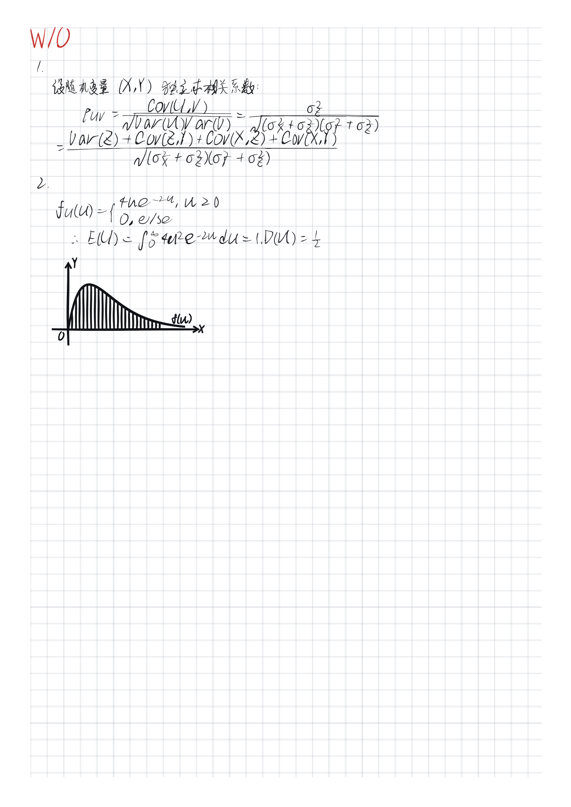
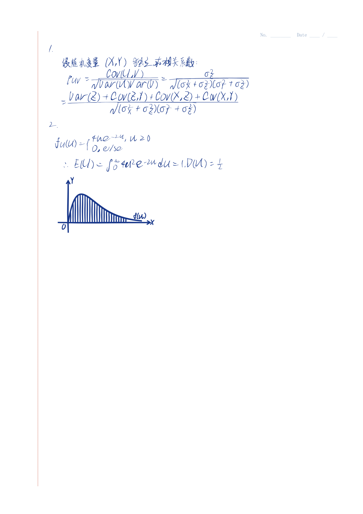
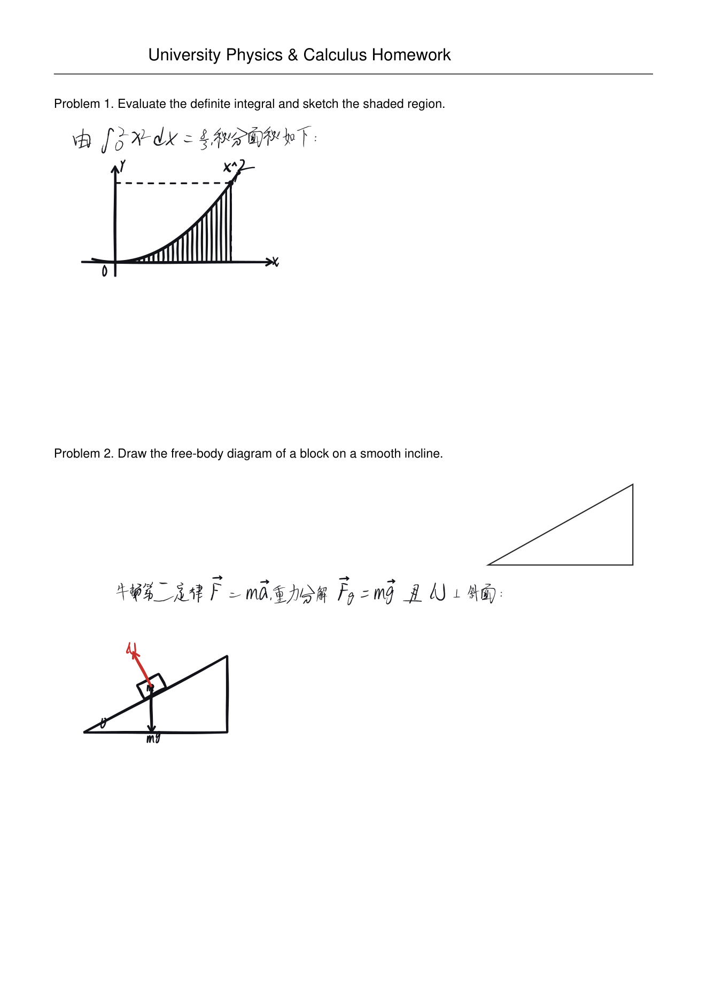

# InkTwin

[](pyproject.toml)
[](LICENSE)
[](#为什么写这个)

把 Markdown + LaTeX 写成**你自己的手写版 PDF**，顺手把你的字迹做成可安装的 `.ttf` / `.otf` 字体。完全跑在本地，不上传笔迹，也没有水印。

*Turn your Markdown + LaTeX notes into vector PDFs in your own handwriting — or compile a personal `.ttf`/`.otf` font. 100% offline, no watermark.*

---

## 先看效果

下面这几张都是用仓库自带的公共示例包 [`packs/demo_sample.hwpack`](packs/demo_sample.hwpack) 在本地离线生成的，还没采自己字迹前就可以直接跑来玩：

| 方格纸 + 长公式自动折行 | 横线练习本（蓝笔 · 工整模式） | 空白原卷直接叠写，不压题干 | 铅笔纸纹质感 |
| :---: | :---: | :---: | :---: |
|  |  |  |  |

---

## 为什么写这个

平时做高数、大物、概率论作业，在电脑上敲 Markdown 和 LaTeX 推导其实挺顺手的，但真要交手写版或者想留一份手写风 PDF 时，照着屏幕一笔一画抄确实太费手了。

之前也试过不少现成的手写生成工具，用下来总有几个别扭的地方：
- 多数工具套的是现成手写字体，同一个字长得完全一样，凑近看一眼印刷味；
- 一碰到积分、矩阵、长连等式、受力草图或者带原题的空白试卷，排版基本就崩了；
- 有的要登录付费、角落打水印，或者得把自己的笔迹样本传到别人服务器上。

于是干脆自己撸了 **InkTwin**。一开始只是想把平时在平板上写过的笔迹复用起来，后来一点点加上了采字帖、生字拼接、长公式断行、原卷留白叠写、笔触质感和本地 Web 工作台，慢慢长成了现在这个工具。

---

## 主要能做什么

- **真用你自己的字迹**：在平板上填 2 页校准字帖导出矢量 PDF，程序按四角定位块直接切格提取成便携的 `.hwpack` 笔迹包（不需要 OCR）。字母、数字、希腊字母、汉字，连分数线、根号、大小括号和向量箭头都是矢量手写轮廓，独立成页的解答层不会混进系统印刷字体。
- **顺手编成系统字体**：同一份 `.hwpack` 可以直接编成 `.ttf` / `.otf` 装到电脑里，带 OpenType `calt` 上下文轮换——在 Word、WPS 里连打 `000`、`aaa`，相邻的相同字符会自动换不同变体。
- **长公式不断腿，生字也能兜底**：内置离线 KaTeX，一长串连等式会自动在合适的外层运算符处折行，不会被硬压成蚂蚁字；碰到字库里还没写过的汉字，会先拿你的偏旁和单笔画拼出风格接近的版本，如果某个常用字觉得不够像，也可以随时出一张靶向小字帖补写进去。
- **空白试卷叠写 & 手绘草图**：支持自动识别空白 PDF / DOCX 试卷里的题号与留白区，把解答直接填回对应位置，也可以在工作台里手动拖框微调；Markdown 表格会自动画出手绘边框，```` ```handplot ```` 代码块能直接画数轴、函数积分阴影图和受力分析图。
- **纸张、墨水、笔触、书写状态都能调**：内置空白、方格（5mm / 6.2mm）、带红竖线横线本、点阵、米黄纸和作文格；笔触可选中性笔（`gel`）、圆珠笔（`ballpoint`）、钢笔（`fountain`）和铅笔（`pencil`）；状态支持 `neat`（工整）、`normal`（日常）和 `rush`（赶 DDL）。
- **不满意还能逐字微调**：渲染时加上 `--save-scene` 会留下一份可编辑场景，空隙太大或左边缘太齐可以自动修一下，也能打开离线单字画布手动拖动、改红笔或按 `R` 换一个手写变体。

---

## 3 分钟跑起来

### 1. 环境准备

- **Python 3.10+**
- 本机装有 **Chrome** 或 **Edge**（只用于本地离线排版，不会联网）

### 2. 安装与自检

```bash
git clone https://github.com/estuardoestrada128-bot/InkTwin.git
cd InkTwin
pip install -e .

# 检查依赖、浏览器路径和离线资源是否就绪
inktwin doctor
```

看到 `ok=True` 就可以开工了。

### 3. 打开本地工作台（推荐）

不想记命令的话，直接起可视化界面最省心：

```bash
inktwin studio
```

浏览器会自动打开本地的 **InkTwin Studio**：
1. **Forge（字库）**：下载字帖 → 上传平板写好的 PDF 建字库 → 一键导出 `.ttf` / `.otf` 字体；
2. **Compose（排版）**：编辑 Markdown + LaTeX、选纸张/墨水/笔触，或者上传空白试卷拖拽调整答题框；
3. **Preview（预览）**：翻页看效果、检查版面异常、做一键微调或导出 PDF / 透明图层。

---

## 常用命令行速览

如果你更习惯在终端或脚本里跑：

**1）先用自带的演示包渲染一篇作业试试**

```bash
inktwin preflight homework.md --pack demo_sample
inktwin render homework.md -o out.pdf --pack demo_sample --paper ruled8 --ink blue --mood neat
```

**2）采集你自己的手写字库 + 编系统字体**

```bash
# 生成 2 页基础校准字帖（还有进阶物理/高数符号帖 --tier tier2）
inktwin template --tier tier1 -o my_tier1.pdf

# 在 StarNote / GoodNotes / Notability / Apple Notes 里写完，导出「矢量 PDF」后建库：
inktwin harvest filled_tier1.pdf -o packs/local/my_hand.hwpack --id my_hand

# 顺手编一份可安装的 .ttf 字体
inktwin fontbuild --pack my_hand --format ttf -o InkTwin-MyHand.ttf
```

以后写具体某次作业遇到没写过的生字，也能只针对那篇文档出一张小字帖补录进去：

```bash
inktwin template --tier targeted --from-md homework.md -p my_hand -o patch.pdf
inktwin harvest filled_patch.pdf -o packs/local/my_hand.hwpack --merge-into my_hand
```

**3）把解答直接叠写到空白试卷 PDF**

```bash
inktwin render solutions.md --overlay blank_exam.pdf --pack my_hand --pen-type fountain -o overlaid.pdf
```

> 更多细节——比如 `handplot` 草图语法、在 Word 里开启 `calt` 多变体轮换、空白试卷自定义 `layout.json`、以及 `InkScene` 逐字编辑快捷键——都放在 [**详细使用手册 docs/GUIDE.md**](docs/GUIDE.md) 里了。

---

## 用之前顺便提几句

- **平板导出务必选矢量 PDF**：填完字帖导出时不要勾选“拼合/栅格化为图片”，否则拿不到真实的矢量笔迹轮廓；书写时也注意别盖住四角的青色小方块。
- **生字合成不是魔法**：字库里还没写过的字会用你的偏旁和单笔画来拼，混在段落里挺自然，但高频字或结构特别复杂的字，还是用上面的 `--tier targeted` 补写一遍最像你自己。
- **开发测试与 Agent 集成**：改完代码可以跑 `python tests/run_tests.py` 和 `python evals/grade.py` 做离线回归与隐私检查；如果你在用 Claude Code、Codex、Cursor 或 Antigravity，也可以运行 `python install.py --agent both --scope project --link` 把它注册成 Skill。

---

## 目录一览

```text
InkTwin/
├── packs/
│   ├── demo_sample.hwpack   # 随仓库附带的公共示例字库
│   └── local/               # 放你自己的私密 .hwpack（已被 .gitignore 忽略）
├── assets/                  # 离线 KaTeX、汉字笔顺骨架库与兜底字体
├── docs/                    # 详细使用手册与示例画廊
├── src/inktwin/             # 核心源码（harvest / synth / mathsplit / overlay / sketch / pen / scene / fontgen / studio）
├── tests/                   # 离线单元测试与回归套件
└── evals/grade.py           # 排版质量与隐私自检脚本
```

---

## 隐私与协议

- 你自己的个人笔迹包请放在 `packs/local/` 下，[.gitignore](.gitignore) 默认已经拦截了整个目录，不用担心顺手推到公开仓库里。
- 仓库中的 [`packs/demo_sample.hwpack`](packs/demo_sample.hwpack) 仅作公开脱敏示例。
- 本项目使用 [MIT License](LICENSE) 开源。如果用着顺手，或者在某类奇葩公式/试卷上翻车了，欢迎直接提 Issue 或 PR。
