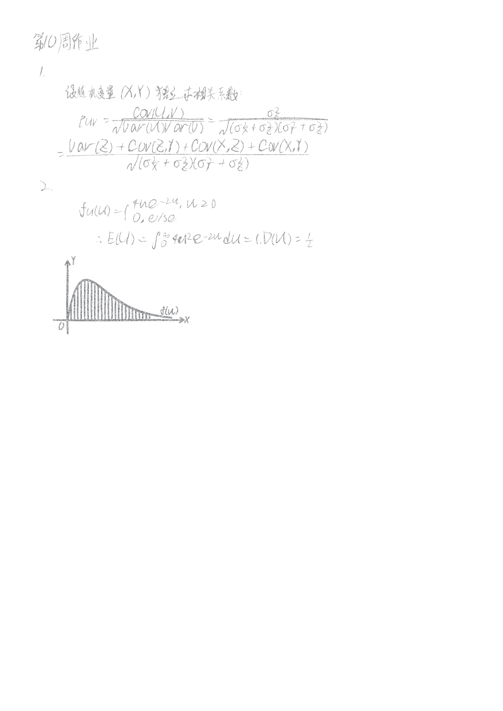

# InkTwin

**100% 本地离线开源 · 零强制水印 · 全学科数理个人手写孪生与矢量排版引擎**  
**100% Offline Open-Source Personal Handwriting Twin & Math/Physics Vector Typesetting Engine**

> 只需用平板在 2 页校准字帖上写下你的真实字迹，即可拥有**专属便携笔迹包（`.hwpack`）+ 系统可安装多变体字体（`.ttf` / `.otf`）**，并将任意 Markdown + LaTeX 推导、表格与数理草图**零字体残留、纯矢量**地渲染在方格纸、横线练习本、作文纸或空白 PDF/DOCX 试卷上。

---

## 效果画廊 / Showcase Gallery

> 以下效果图均由仓库自带的公开脱敏字库包 [`packs/demo_sample.hwpack`](packs/demo_sample.hwpack) 在纯离线环境下生成：

| 独立方格算纸与长公式智能断行 | 横线练习本（蓝笔 · `neat`） | 空白物理/微积分原卷无损叠写 | 铅笔纸纹物理材质层 |
| :---: | :---: | :---: | :---: |
|  |  |  |  |

---

## 为什么选择 InkTwin？ / Why InkTwin

- **100% 本地离线、零账号、零水印**：所有模型、字库与渲染引擎全部运行在本机，没有任何云端 API 调用、付费墙或强加角落水印。
- **全科统一个人真迹（`visible_font_spans == 0`）**：英文、数字、希腊字母、汉字、大学物理符号（`ℏ ℓ ∮ ∬ ∭ ∇ ∝ ⊥ ⟨ ⟩ ⊆ ∉`），以及分数线、根号勾、大小括号、`\vec{}` 箭头全部采用保压感实心矢量轮廓（经双向 EDT 校准至 `0.74px`）。独立页渲染的 PDF **解答层零系统字体残留**。
- **长公式按运算符智能断行（`Formula Chain Splitter`）**：在括号深度为 0 的 `=`、`⇒`、`⇔`、`≤`、`+`、`-` 处自动拆链折行，前导词（`∵ / ∴ / 故 / 得`）紧贴同行起笔，彻底告别长公式被硬缩成“蚂蚁字”。
- **空白 PDF / DOCX 原卷留白检测与无损叠写**：自动扫描空白试卷的印刷文字、配图障碍与答题空白框，也可在 **Web Studio 中手动拖拽、缩放、增删答题框**，精确叠写且零压题干（`prompt_collision == 0`）。
- **手绘风表格 & 声明式草图块（`handplot`）**：Markdown `<table>` 自动铺设带自然交点出头与微曲度的真迹压感边框线；```` ```handplot ```` 代码块零字体绘制数轴区间（`number_line`）、函数积分阴影图（`func`）与物理受力分析图（`fbd`）。
- **纸面毫米锚定笔触材质**：除默认清爽纯矢量中性笔（`gel`）外，支持圆珠笔（`ballpoint` 油墨浓淡波纹+微飞白）、钢笔（`fountain` 毛细纤维微洇墨）与铅笔（`pencil` 纸纹石墨颗粒）。
- **双轨输出**：既能导出支持 `InkScene` 逐字微调的矢量 PDF / 透明底 SVG / PNG 图层包，也能直接编译为含 OpenType `calt` 上下文多变体轮换的 `.ttf` / `.otf` 系统字体。

---

## 三分钟快速开始 / 3-Minute Quick Start

### 1. 环境准备

- **Python 3.10+**
- 本机已安装 **Google Chrome** 或 **Microsoft Edge**（用于 DOM 与 KaTeX 离线排版引擎）

### 2. 安装与自检

```bash
git clone https://github.com/estuardoestrada128-bot/InkTwin.git
cd InkTwin
pip install -e .

# 检查 Python 依赖、浏览器路径、离线资源与可用字库包
inktwin doctor --json
```

看到 `"ok": true` 即表示环境就绪。

### 3. 启动可视化工作台（推荐新手首选）

```bash
inktwin studio
```

浏览器会自动打开本地离线工作台 **InkTwin Studio**：
1. **① 字库工坊 Forge**：下载字帖 PDF → 上传平板写好的 PDF 极速建库 → 一键编译 `.ttf` / `.otf` 字体；
2. **② 排版 Compose**：编辑 Markdown + LaTeX → 预检生字覆盖率 → 选择纸张/墨水/笔触/书写状态，或上传空白试卷 PDF **拖拽调整答题框**；
3. **③ 预览与微调 Preview**：逐页预览结果、查看 `Inspect` 几何体检报告、一键 `tighten`/`drift` 自愈、切换铅笔/钢笔材质，或导出透明 SVG/PNG 图层与逐字编辑器。

---

## 五步掌握全部工作流 / Complete CLI Workflows

> 所有 CLI 子命令默认支持 `--json` 输出结构化结果，便于人工脚本或 AI Agent 编排。更多细节（`handplot` 全参数、字体安装、快捷键说明）请参阅 [**完整使用手册 docs/GUIDE.md**](docs/GUIDE.md)。

### 场景一：5 分钟采集并锻造你自己的手写字库 + 系统字体

1. **生成校准字帖 PDF**：
   ```bash
   # Tier 1：2 页极速启动帖（数字/字母/算符/分数线/根号 + 笔画 DNA/24偏旁/高频数理汉字）
   inktwin template --tier tier1 -o my_tier1.pdf

   # 可选 Tier 2：1 页物理/高数进阶帖（完整希腊字母、∇、∮、ℏ 等）
   inktwin template --tier tier2 -o my_tier2.pdf
   ```
2. **在平板上填写并导出矢量 PDF**：
   将 `my_tier1.pdf` 导入 StarNote / GoodNotes / Notability / Apple Notes，用深色笔在蓝框内自然书写（**注意不要遮挡四角青色定位方块**），随后导出为 **矢量 PDF**（勿选纯图片栅格化导出）。
3. **零 OCR 极速建库**：
   ```bash
   inktwin harvest filled_tier1.pdf -o packs/local/my_hand.hwpack --id my_hand --json
   ```
   > 若日后写特定作业遇到了未收录生字，只需先 `preflight` 再出靶向微字帖，写完增量合并即可：
   > ```bash
   > inktwin template --tier targeted --from-md hw.md -p my_hand -o patch.pdf
   > inktwin harvest filled_patch.pdf -o packs/local/my_hand.hwpack --merge-into my_hand
   > ```
4. **编译可安装的系统字体（`.ttf` / `.otf`）**：
   ```bash
   inktwin fontbuild --pack my_hand --format ttf -o InkTwin-MyHand.ttf --json
   ```
   安装到 Windows / macOS 后，在 Word / WPS / 支持 OpenType `calt` 的软件中连续输入相同数字或字母（如 `000`、`aaa`），字体会自动轮换不同手写变体。

---

### 场景二：Markdown + LaTeX 作业极简渲染（无需字库也可先用演示包体验）

```bash
# 1. 渲染前预检：查看个人真迹汉字覆盖率、合成生字列表与超长公式自动拆链数量
inktwin preflight homework.md --pack demo_sample --json

# 2. 生成手写版 PDF（自动输出至同目录，并可选保存可编辑 InkScene 与透明图层）
inktwin render homework.md -o out.pdf \
  --pack demo_sample \
  --paper ruled8 \
  --page-size A4 \
  --ink blue \
  --mood neat \
  --pen-type gel \
  --save-scene out_scene \
  --export-layers layers_out
```

**常用排版参数速查**：
| 参数 | 可选值 | 说明 |
| :--- | :--- | :--- |
| `--pack, -p` | `demo_sample` / `my_hand` / 路径 | 指定 `.hwpack` 笔迹包（`packs/local/` 优先） |
| `--paper` | `auto`, `white`, `grid`, `grid5`, `ruled8`, `ruled7`, `dots`, `cream`, `compo` | 底纸样式（`ruled8` 带左红竖线与 `No./Date` 眉头；`compo` 作文纸自动锁定格心） |
| `--page-size` | `A4`, `B5`, `16K`, `LETTER` | 物理纸张尺寸（全流程以 `mm` 计算） |
| `--ink` | `black`, `blue`, `darkblue`, `pencil` | 墨水颜色预设 |
| `--mood` | `neat`, `normal`, `rush` | 书写节奏与状态（工整 / 日常 / 赶工，越赶越紧凑倾斜且含自然微瑕，可用 `--no-quirks` 关闭微瑕） |
| `--pen-type` | `gel`, `ballpoint`, `fountain`, `pencil` | 物理笔触材质（默认 `gel` 为纯矢量；其余按页面物理毫米坐标施加飞白/洇墨/石墨颗粒） |

---

### 场景三：空白 PDF 试卷/作业原卷无损叠写 + `handplot` 草图 + 手绘表格

将你的 Markdown 解答直接按题号填回空白原卷 PDF 的留白区：

```bash
# 方式 A：全自动检测空白区并叠写
inktwin render solutions.md --overlay blank_exam.pdf --pack my_hand --pen-type fountain -o overlaid.pdf --json

# 方式 B：先导出 layout.json 查看或微调空白框坐标，再叠写
inktwin layout-detect blank_exam.pdf -o layout.json --min-slot-mm 18 --json
inktwin render solutions.md --overlay blank_exam.pdf --layout-json layout.json -o overlaid.pdf
```

> 解答文件中的二级标题（如 `## 1.`、`## 第2题`、`## 【题3】`、`## Problem 4`）会自动与原卷对应题号下方检测到的留白框对齐。

在 Markdown 中嵌入 `handplot` 声明式手绘草图块：

````markdown
```handplot
type: func
width_mm: 64
height_mm: 40
x_range: [-0.5, 2.6]
y_range: [-0.5, 4.5]
shade:
  expr: "x**2"
  from: 0
  to: 2
curves:
  - expr: "x**2"
    domain: [-0.4, 2.15]
    label: "x^2"
points:
  - x: 2
    y: 4
    label: "P"
    dashed_proj: true
```
````

更多 `number_line`（数轴区间）与 `fbd`（斜面物理受力图）写法详见 [docs/GUIDE.md](docs/GUIDE.md)。

---

### 场景四：非破坏性 `InkScene` 几何体检与单字级微调

渲染时加上 `--save-scene my_scene` 会保存只读基准 `scene.json` 与增量编辑栈 `edits.json`：

```bash
# 扫描大空隙 (gap)、重叠 (overlap)、越界 (outside_margin)、压题干 (prompt_collision) 与左边缘过齐
inktwin inspect my_scene --json

# 一键自愈算子
inktwin scene tighten my_scene        # 自动收拢异常大空隙
inktwin scene drift my_scene          # 为机械笔直的左边缘注入自然手掌右漂

# 打开单文件离线逐字画布（点击拖动/缩放/切红笔，按 R 键切换同一字符的下一真迹变体）
inktwin scene editor my_scene

# 应用修改并极速重绘（<0.3s）或导出透明图层
inktwin scene render my_scene -o edited.pdf
inktwin scene render my_scene --out-dir layers --format png --transparent --pen-type pencil
```

---

### 场景五：一键接入 AI Coding Agents & 自动化评测

```bash
# 为 Claude Code / Codex / Cursor / Antigravity 注册 InkTwin 技能（支持 --link 开发软链）
python install.py --agent both --scope project --link

# 运行自动化回归测试（8 项全流程集成测试）
python tests/run_tests.py

# 运行结果导向硬指标评测与隐私泄露审计
python evals/grade.py --pack demo_sample --json
```

---

## 项目结构 / Repository Layout

```text
InkTwin/
├── pyproject.toml           # 包配置与 CLI 入口注册
├── install.py               # 跨 AI Agent 技能安装器
├── packs/
│   ├── demo_sample.hwpack   # 开源脱敏演示包（随仓库发布）
│   └── local/               # .gitignore 忽略目录：存放你的私密个人 .hwpack
├── assets/                  # 离线 KaTeX 资源、5万字汉字笔顺中轴库、兜底字体
├── docs/
│   ├── GUIDE.md             # 进阶详细使用手册
│   └── gallery/             # 脱敏演示画廊图片
├── evals/grade.py           # 结果导向质量打分与隐私审计脚本
├── tests/                   # 离线单元测试与端到端回归套件
└── src/inktwin/
    ├── cli.py               # 统一命令行入口
    ├── pack/                # .hwpack 读写、9维画像、物理符号生成
    ├── harvest/             # 四角靶标校准字帖、0-OCR 切格与 EDT 0.74px 校准
    ├── fontgen/             # fonttools OpenType (.ttf/.otf + GSUB calt) 编译器
    ├── synth/               # 汉字偏旁克隆、单笔画嫁接与状态连笔合成
    ├── mathsplit/           # 学生规范清洗器与顶层运算符长公式断行器
    ├── paper/               # 物理毫米 (mm) 纸张库
    ├── sketch/              # 零字体 handplot 草图引擎与手绘表格规则
    ├── overlay/             # 空白 PDF/DOCX 留白框识别与无损叠写
    ├── scene/               # InkScene、inspect、tighten/drift 与逐字编辑器
    ├── pen/                 # 页面毫米锚定物理笔触材质层
    └── studio/              # InkTwin Studio 统一离线 Web 工作台
```

---

## 隐私说明与开源协议 / Privacy & License

- 本项目**默认严禁提交任何个人笔迹**：`packs/local/` 已在 `.gitignore` 中永久忽略。
- `packs/demo_sample.hwpack` 仅作为开源脱敏演示样本提供。
- 本项目采用 [MIT License](LICENSE) 开源。
